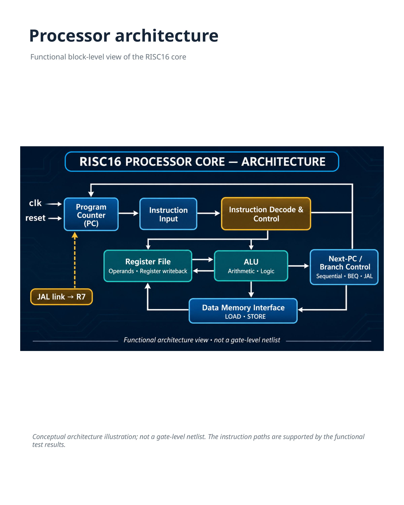
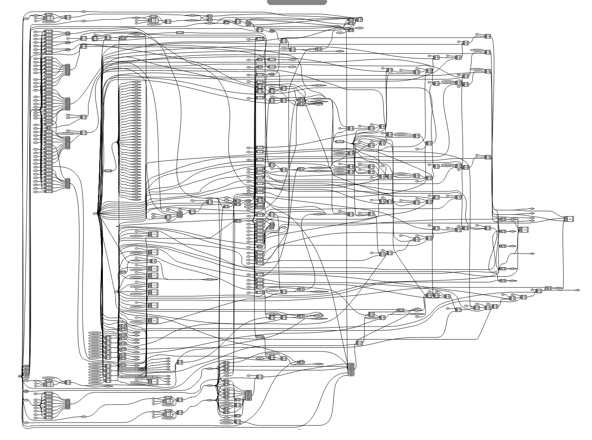
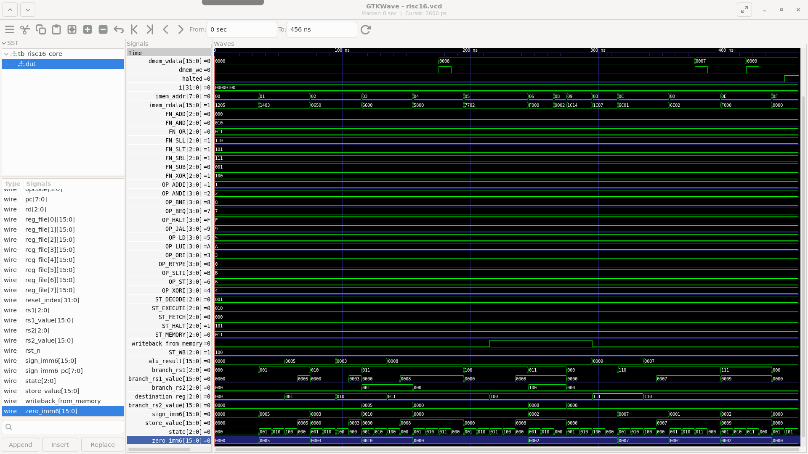
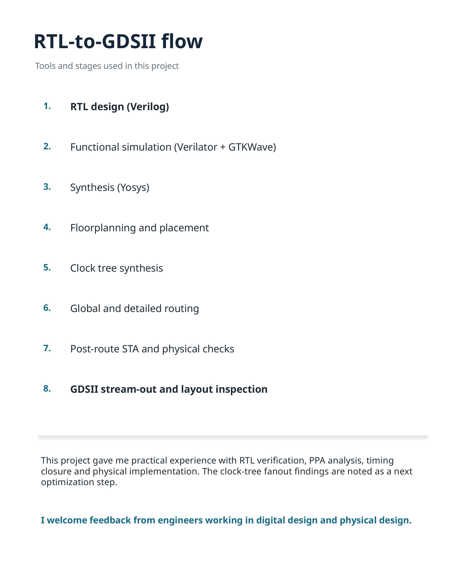
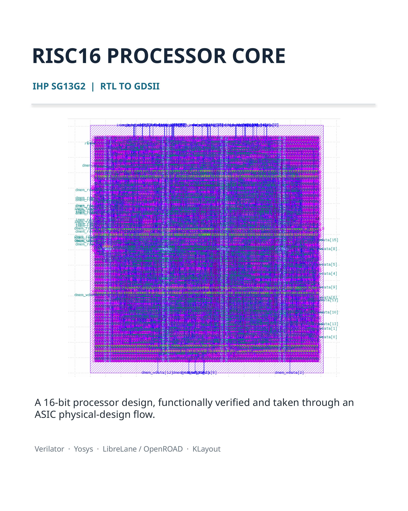
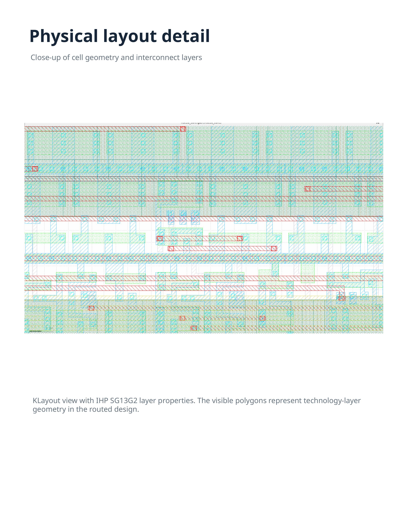
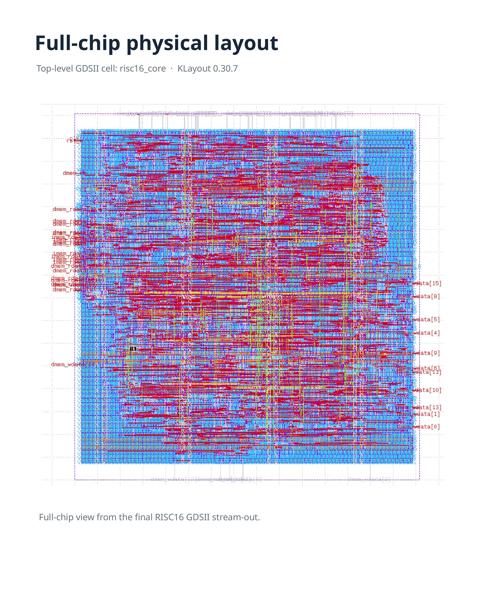
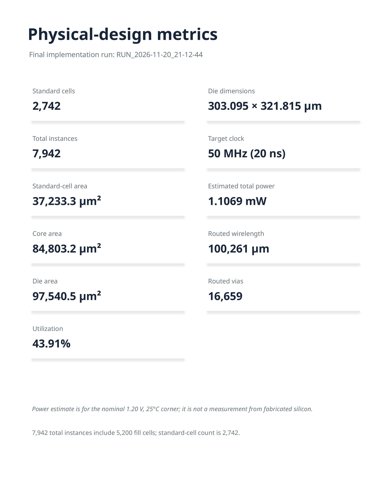
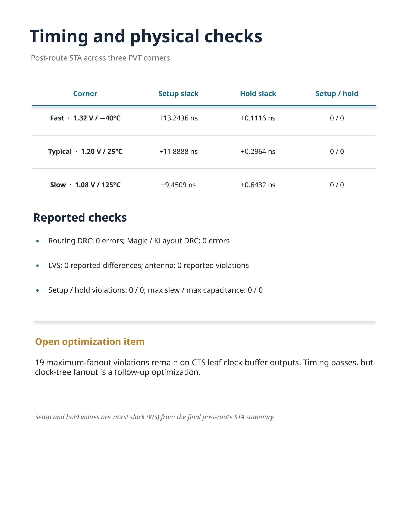

# RISC16 Processor Core — IHP SG13G2

A custom 16-bit multi-cycle RISC processor implemented in Verilog and taken through an RTL-to-GDSII ASIC physical-design flow using the IHP SG13G2 technology and open-source EDA tools.

This project demonstrates digital design, RTL verification, synthesis, physical implementation, timing analysis, power estimation, and physical verification.

> **Note:** RISC16 uses a custom instruction set. It is not an implementation of RISC-V.

---

## 1. Project Overview

| Parameter | Specification |
|---|---|
| Processor | Custom RISC16 |
| Architecture | 16-bit multi-cycle RISC |
| RTL language | Verilog |
| Verification | SystemVerilog |
| Registers | 8 general-purpose registers |
| Datapath width | 16 bits |
| Program counter | 8-bit word-addressed |
| Controller | Multi-cycle FSM |
| Technology | IHP SG13G2 |
| Target clock period | 20 ns |
| Target frequency | 50 MHz |
| Physical implementation | RTL-to-GDSII |

### Architecture Overview



### Processor Schematic



### Architectural Features

- 16-bit datapath and custom instruction set.
- Eight 16-bit general-purpose registers.
- R0 hardwired to zero.
- R7 used as the JAL link register.
- 8-bit word-addressed program counter.
- Separate instruction and data memory interfaces.
- Multi-cycle finite-state-machine controller.
- Active-low synchronous reset.

Refer to [ISA.md](ISA.md) for complete instruction encodings and architectural details.

---

## 2. Instruction Set Architecture

The custom RISC16 instruction set includes the following instructions.

| Category | Instructions |
|---|---|
| Arithmetic | ADD, SUB, ADDI |
| Logical | AND, OR, XOR, ANDI, ORI, XORI |
| Comparison | SLT, SLTI |
| Shift | SLL, SRL |
| Memory | LD, ST |
| Branch | BEQ, BNE |
| Jump | JAL |
| Upper immediate | LUI |
| Control | HALT |

The RTL testbench exercises arithmetic, memory access, branching, jump/link, and halt operations.

**ISA documentation:** [ISA.md](ISA.md)

---

## 3. RTL Functional Verification

RTL simulation was performed using Verilator 5.044 with a self-checking SystemVerilog testbench.

### Simulation Results

```text
PASS: RISC16 test completed in 43 cycles

MEM[0] = 8
MEM[1] = 7
MEM[2] = 9

HALTED = 1
```

### GTKWave Simulation



### Simulation Artifacts

- [RTL simulation log](results/simulation/rtl_simulation.log)
- [VCD waveform dump](results/simulation/risc16.vcd)
- [SystemVerilog testbench](tb/tb_risc16_core.sv)

The reported 43-cycle result is from RTL functional simulation, not post-layout SDF simulation.

---

## 4. RTL-to-GDSII Implementation Flow

The processor was taken through an ASIC implementation flow targeting the IHP SG13G2 process.



The implementation includes:

1. RTL design and functional verification.
2. Generic and technology-specific synthesis.
3. Technology mapping for IHP SG13G2.
4. Physical implementation and routing.
5. Post-route timing and power analysis.
6. Physical verification and final implementation checks.

**Reported physical-design flow completion: 80/80 steps.**

### Implementation Scripts

- [Verilator simulation script](scripts/run_verilator.sh)
- [Generic synthesis script](scripts/synth_generic.ys)
- [IHP SG13G2 synthesis script](scripts/synth_ihp.ys)
- [Project configuration](config.yaml)

---

## 5. Physical Design Results

### Full Chip Layout



### Detailed Layout



### Routing Detail



### Area and Utilization

| Metric | Result |
|---|---:|
| Standard-cell area | 37,233.3 µm² |
| Core area | 84,803.2 µm² |
| Die area | 97,540.5 µm² |
| Die width | 303.095 µm |
| Die height | 321.815 µm |
| Core utilization | 43.9055% |
| Standard cells | 2,742 |
| Total instances | 7,942 |
| Routed wirelength | 100,261 µm |
| Routed vias | 16,659 |

Total instances include physical-only cells such as fill cells.

---

## 6. Post-Route Timing Analysis

Target clock period: **20 ns**

Target frequency: **50 MHz**

### Timing Results Across PVT Corners

| PVT Corner | Voltage | Temperature | Setup Slack | Hold Slack |
|---|---:|---:|---:|---:|
| Fast | 1.32 V | -40°C | +13.2436 ns | +0.1116 ns |
| Typical | 1.20 V | 25°C | +11.8888 ns | +0.2964 ns |
| Slow | 1.08 V | 125°C | +9.4509 ns | +0.6432 ns |

### Timing Summary

- Setup violations: 0
- Hold violations: 0
- Setup TNS: 0 ns
- Hold TNS: 0 ns
- Maximum slew violations: 0
- Maximum capacitance violations: 0

All three reported PVT corners have positive setup and hold slack.

---

## 7. Power Estimation

Nominal analysis corner: 1.20 V, 25°C.

| Power Component | Estimated Power |
|---|---:|
| Internal power | 0.837211 mW |
| Switching power | 0.266548 mW |
| Leakage power | 0.003162 mW |
| **Total power** | **1.106921 mW** |

### PPA Metrics



These are EDA power estimates, not measured silicon power.

---

## 8. Physical Verification and Signoff

### Signoff Summary



### Physical Verification Results

| Verification | Reported Result |
|---|---|
| Routing DRC | 0 errors |
| Magic DRC | 0 errors |
| KLayout DRC | 0 errors |
| LVS | 0 reported differences |
| Antenna | 0 reported violations |
| Power-grid checks | 0 reported violations |
| Setup violations | 0 |
| Hold violations | 0 |

### Known Implementation Issue

The final checks report 19 maximum-fanout violations associated with CTS leaf clock-buffer outputs.

These remain a clock-tree optimization item. They are disclosed here for accuracy; setup and hold timing violation counts remain zero.

---

## 9. Gate-Level Connectivity Showcase

The project includes a generated gate-level connectivity graph.

- [Gate-level connectivity SVG](showcase/schematic/risc16_gate.svg)
- [Graphviz DOT source](showcase/schematic/risc16_gate.dot)

The DOT source is retained for future graph regeneration and inspection.

---

## 10. Tools and Technologies

| Tool / Technology | Application |
|---|---|
| Verilog | RTL design |
| SystemVerilog | Functional testbench |
| Verilator 5.044 | RTL simulation |
| Yosys | Logic synthesis |
| OpenROAD | Physical implementation |
| IHP SG13G2 | Target technology |
| Magic | Physical verification |
| KLayout | Layout inspection and DRC |
| GTKWave | Simulation waveform analysis |
| Graphviz | Gate-level connectivity visualization |

---

## 11. Repository Structure

```text
ihp-sg13g2-risc16/
│
├── README.md
├── ISA.md
├── config.yaml
├── .gitignore
│
├── src/
│   └── risc16_core.v
│
├── tb/
│   └── tb_risc16_core.sv
│
├── scripts/
│   ├── run_verilator.sh
│   ├── synth_generic.ys
│   └── synth_ihp.ys
│
├── docs/
│   ├── architecture/
│   ├── layout/
│   ├── simulation/
│   ├── metrics/
│   └── reports/
│
├── results/
│   └── simulation/
│
└── showcase/
    └── schematic/
        ├── risc16_schematic.jpeg
        ├── risc16_gate.dot
        └── risc16_gate.svg
```

---

## 12. Project Documentation

Additional project resources:

- [Complete physical-design metrics](docs/metrics/PROJECT_METRICS.md)
- [Instruction Set Architecture](ISA.md)
- [Project Configuration](config.yaml)
- [RTL Source](src/risc16_core.v)
- [RTL Testbench](tb/tb_risc16_core.sv)
- [Simulation Results](results/simulation/)

---

## 13. Project Summary

RISC16 demonstrates the development of a custom 16-bit processor from RTL design through ASIC physical implementation using IHP SG13G2.

The project brings together:

- Custom processor architecture and instruction-set design.
- Verilog RTL development.
- SystemVerilog functional verification.
- Logic synthesis and technology mapping.
- ASIC physical implementation and routing.
- Post-route timing and power analysis.
- DRC, LVS, and antenna verification.
- Gate-level connectivity visualization.

**Target Technology:** IHP SG13G2

**Target Frequency:** 50 MHz

**Reported Physical-Design Flow:** 80/80 steps completed.

---

